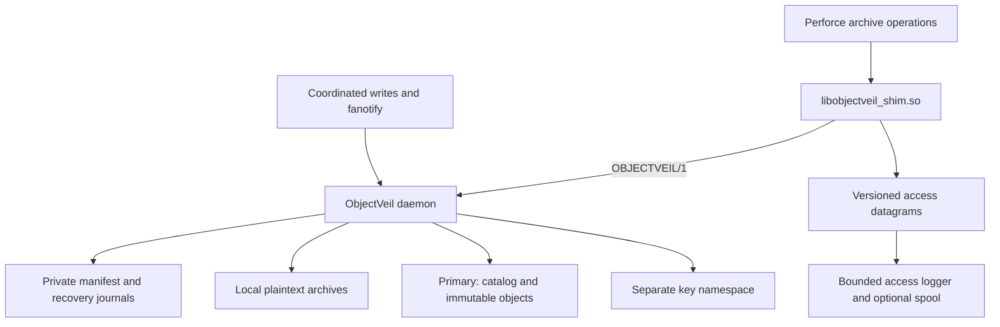

# ObjectVeil architecture

ObjectVeil maintains a local plaintext archive cache backed by immutable objects,
a durable catalog and, for encrypted deployments, a separate keystore. Perforce
is the qualified application integration. Other applications need their own
write, deletion and completeness qualification; see
[application qualification](design/perforce-coupling.md).

## Native identity and startup

Configuration requires `format: "objectveil/1"` and an explicit canonical,
non-nil `namespace_id` UUID. That identity is immutable for a running process.
The default state path is `depot_path/.objectveil`; explicit state paths are
subject to the same ownership validation. Populated unmarked state is refused.

`objectveil-initialize` checks an empty archive root, or an existing archive-only
root explicitly attested with `--existing-archives`, before publishing local
ownership and archive-root proof. It does not copy archives, establish a source
snapshot or convert incompatible state. The daemon requires that proof before
license anchors, manifests or watchers can write. See [upgrading](upgrading.md).

Primary and key backends carry role-specific `objectveil-native-storage`
version 1 markers bound to the same namespace UUID. A writer may claim fresh
empty namespaces. A partially initialized pair can resume only while both remain
empty except for their markers. Read-only clients cannot initialize stores.
Missing, malformed, foreign-role or foreign-UUID identity fails closed.

The shim requires canonical `OBJECTVEIL_*` configuration and `OBJECTVEIL/1`
requests. An absent managed root is a startup failure unless the shim is
explicitly disabled. There is no unversioned request or alternate-format decoder.
Socket pointer files and access datagrams also have mandatory native headers.

## Durable state and authority

| State | Purpose |
| --- | --- |
| Local `manifest.redb` | File generations, durable dirty work, LRU, pending deletion/eviction recovery and catalog mirrors. Native file records use the `OV` binary discriminator. |
| Remote catalog | Native version 3 checksummed causal Put/Remove history for packed, standalone and deduplicated objects. Local catalog rows are mirrors. |
| Writer-era tickets | Permanent create-once records ordering a replacement writer after prior writers; not leader election. |
| Primary payloads | Immutable standalone objects, packed chunks and shared encrypted blobs. |
| Separate keystore | Live path/content keys and exact poison histories; loss of a live key loses encrypted data. |
| Migration/verifier state | Dedicated owned directories and locks, separate from the daemon manifest. |
| Access spool | Optional owned, bounded telemetry persistence; never an archive durability substitute. |

A complete catalog Remove suppresses restoration and reconstruction. An incomplete
or corrupt authority read is not absence. Dedup routing lives in the catalog;
a populated independent `routes/` namespace is unsupported and refused.

## Write, restore and eviction

Supported shim writers coordinate open descriptors with eviction. The watcher
records dirty observations durably and periodically reconciles the archive tree.
An upload captures a private stable generation, resolves its key, publishes
immutable data and durable catalog authority, then marks only that generation
Clean. Uploads target the primary; a secondary is not synchronous replication.

Writer reads can use valid local data. Read-only caches check current remote
authority on every new managed open, including local hits. An unknown or Dirty
local file is preserved and refused. A stale verified local file remains intact
while its replacement is downloaded and authenticated. Only successful private
staging permits replacement; the publication window is journaled for recovery.
Already-open descriptors retain their existing inode contents.

Cold FETCH work is detached and bounded; cancellation of a waiting RPC does not
release a still-running restore's admission. FETCH and writer STAT share the
configured worker bound. Versioned asynchronous STAT uses bounded tickets and
expiry. The shim applies one total operation deadline across connection, polling
and retries. Readiness requires the full engine; socket existence alone is not
readiness.

Eviction requires a Clean matching generation, verified recoverable remote
content and exclusion of active writers. A durable held-inode journal covers the
local unlink and metadata transition. Startup reconciles incomplete operations
before admitting unsafe work. Read-only mode still evicts its local cache; it
rejects managed writes and authoritative deletion.

## Deletion and recovery limits

Deletion persists a generation-specific intent, removes local plaintext durably,
poisons the selected key epoch, publishes a catalog tombstone and clears the
intent last. Deduplicated paths revoke access individually; destruction of the
shared content key requires complete last-reference proof. Unknown orphan blobs
are retained. See [crypto-shred](design/obliterate-crypto-shred.md) and
[content deduplication](design/content-dedup.md).

Perforce submit acknowledgement is asynchronous with respect to cloud publication.
Total loss of the writer and its disks can lose acknowledged but unpublished
archives. Recovery needs the surviving catalog, payloads, live keys, poison
histories and writer-era tickets, plus independent Perforce metadata backups.
Checksums are corruption checks, not authenticity against a storage administrator
who can replace both data and checksum. Provider retention or key backups can
defeat permanent erasure.

## Distributed tools

The package contains eight executables and the matching preload library:
`objectveil`, `objectveil-initialize`, `objectveil-migrate`, `objectveil-verify`,
`objectveil-manifest-summary`, `objectveil-rebuild-catalog`, `objectveil-rescan`,
`objectveil-dedup-measure`, and `libobjectveil_shim.so`. The daemon, initializer and
migration executable include runtime integrity checks. Release acceptance applies
to the exact tested binaries and evidence, not this architectural description.

See [configuration](CONFIGURATION.md), [operations](OPERATIONS.md),
[migration](migration.md), [tuning](TUNING.md) and
[disaster recovery](disaster-recovery.md).
